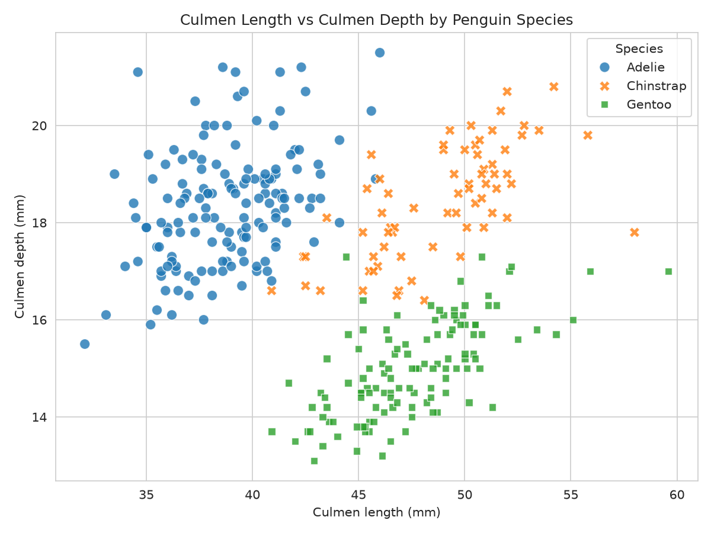
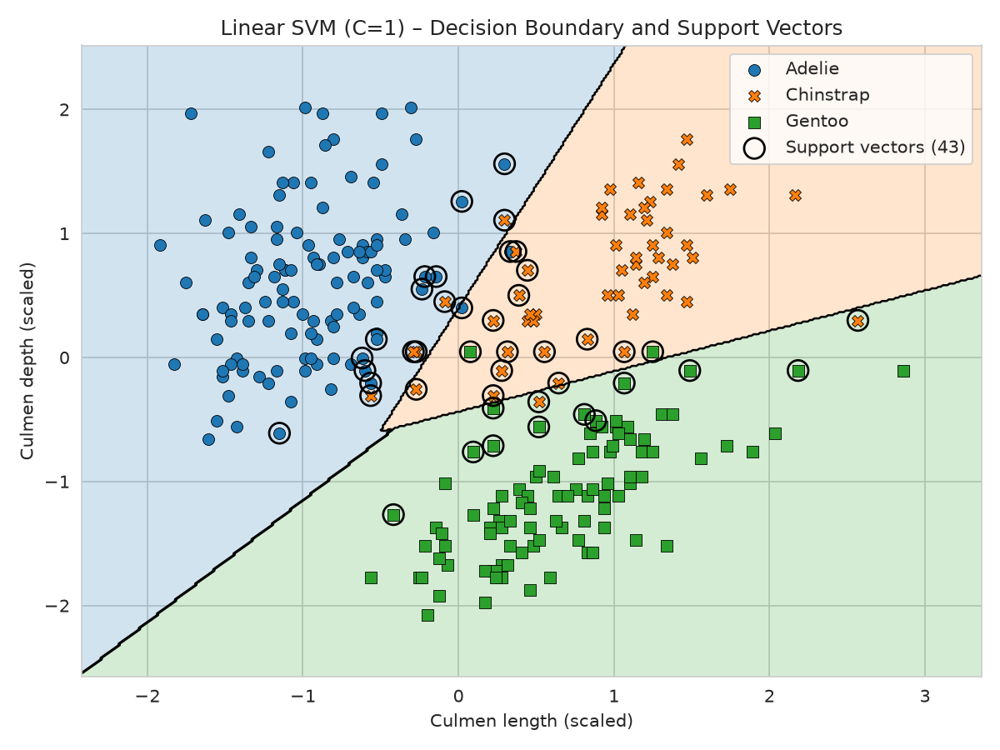
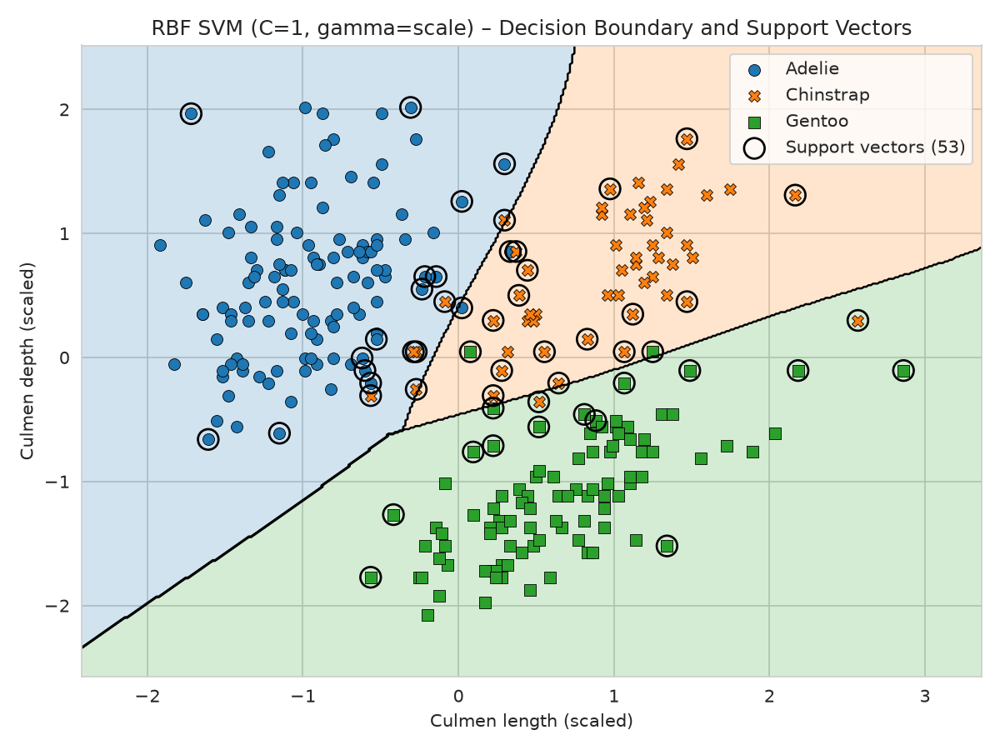
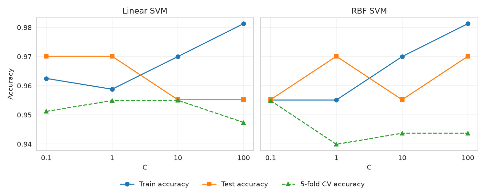
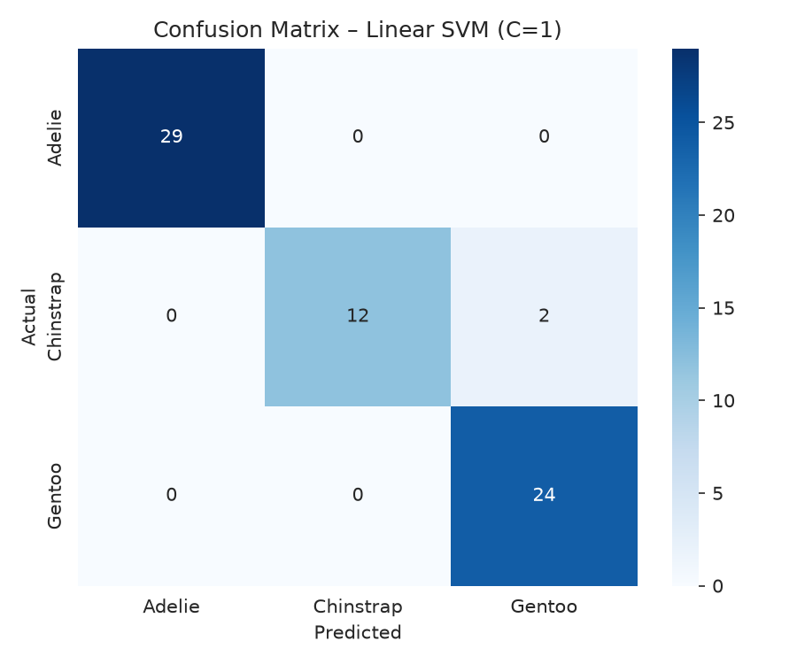

# Penguin Species Classification Using Support Vector Machine

Course project for **AMDS3002 – Introduction to Machine Learning / CSCI4221 – Machine Learning and Predictive Analytics**
(Prof. Kaushik Deb, Asian University for Women & CUET).

**Objective:** build an SVM model that predicts whether a penguin is an **Adelie**, **Chinstrap**, or **Gentoo** from its physical measurements.

## Dataset

| Item | Details |
|---|---|
| Name | Palmer Penguins Dataset |
| Source | [Kaggle – Palmer Archipelago (Antarctica) penguin data](https://www.kaggle.com/datasets/parulpandey/palmer-archipelago-antarctica-penguin-data) |
| Records | 344 penguins |
| Target | `species` (Adelie 152, Gentoo 124, Chinstrap 68) |
| Features | culmen length, culmen depth, flipper length, body mass |
| Missing values | 10 rows contain at least one missing value |

**Reference:** Gorman KB, Williams TD, Fraser WR (2014). *Ecological Sexual Dimorphism and Environmental Variability within a Community of Antarctic Penguins (Genus Pygoscelis).* PLoS ONE 9(3): e90081. [doi:10.1371/journal.pone.0090081](https://doi.org/10.1371/journal.pone.0090081)

## Repository structure

```
penguin-svm-classification/
├── data/penguins_size.csv
├── notebooks/penguin_svm.ipynb
├── images/
├── requirements.txt
├── .gitignore
└── README.md
```

## Getting started

```bash
git clone https://github.com/<zainnm30>/penguin-svm-classification.git
cd penguin-svm-classification
pip install -r requirements.txt
jupyter notebook notebooks/penguin_svm.ipynb
```

## Progress

- [x] **Task 1** – Load dataset; display `head()`, `shape`, `info()`, missing values
- [x] Task 2 – Drop missing records; choose two input features
- [x] Task 3 – Scatter plot of the three species and two observations
- [x] Task 4 – 80/20 train–test split and `StandardScaler`
- [x] Task 5 – Linear SVM (`C=1`)
- [x] Task 6 – Accuracy, confusion matrix, classification report
- [x] Task 7 – Linear SVM decision boundary and support vectors
- [x] Task 8 – RBF SVM vs Linear SVM
- [x] Task 9 – Test `C = 0.1, 1, 10, 100`
- [ ] Required questions and final observation

## Results

Features used: **culmen length** and **culmen depth** (334 penguins after `dropna()`; 80/20 stratified split, `random_state=42`, `StandardScaler` fitted on the training set only).

### Linear vs RBF SVM (C = 1)

| Model | C | Train accuracy | Test accuracy | Support vectors |
|---|---|---|---|---|
| Linear SVM | 1 | 0.9588 | 0.9701 | 43 |
| RBF SVM | 1 | 0.9551 | 0.9701 | 53 |

Both models classify **65 of 67** test penguins correctly. The only errors are 2 Chinstrap penguins predicted as Gentoo.

### Effect of C

| Kernel | C | Train acc. | Test acc. | Support vectors | 5-fold CV acc. |
|---|---|---|---|---|---|
| Linear | 0.1 | 0.9625 | 0.9701 | 88 | 0.9512 |
| Linear | 1 | 0.9588 | 0.9701 | 43 | 0.9549 |
| Linear | 10 | 0.9700 | 0.9552 | 26 | 0.9550 |
| Linear | 100 | 0.9813 | 0.9552 | 22 | 0.9474 |
| RBF | 0.1 | 0.9551 | 0.9552 | 123 | 0.9549 |
| RBF | 1 | 0.9551 | 0.9701 | 53 | 0.9399 |
| RBF | 10 | 0.9700 | 0.9552 | 35 | 0.9437 |
| RBF | 100 | 0.9813 | 0.9701 | 27 | 0.9437 |

### Key findings

- **Gentoo** is the easiest species to separate (low culmen depth). **Adelie and Chinstrap** overlap the most, and are separated mainly by culmen length.
- RBF gave **no accuracy gain** over Linear here, because the classes are almost linearly separable in these two features.
- **C = 1** gave the best test accuracy for both kernels (RBF tied with C = 100). Larger C raised training accuracy without improving test accuracy. The differences between settings are about one test penguin, so C = 1 is a sensible choice but not a decisive one.
- **Feature scaling matters.** Without it, test accuracy dropped to 95.52% (Linear) and 92.54% (RBF), against 97.01% with scaling.

### Figures

| Scatter plot | Linear SVM boundary |
|---|---|
|  |  |

| RBF SVM boundary | Effect of C |
|---|---|
|  |  |

| Confusion matrix (Linear) | Confusion matrix (RBF) |
|---|---|
|  |  |

### Limitations

Single train/test split with only 67 test penguins; only two of the four features were used; RBF `gamma` was not tuned.


## Author

`<Zainab Mohammadi>` · Asian University for Women
